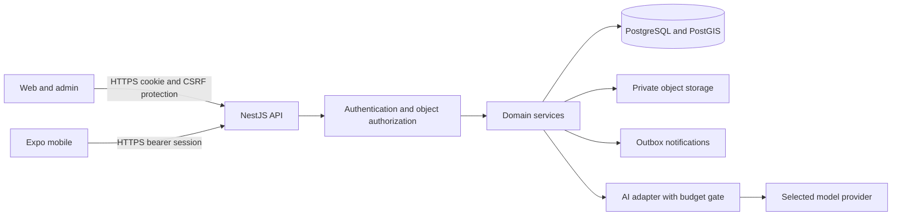

# Proposed architecture

Status: proposed, not implemented. Date: 2026-10-12 (Asia/Kolkata). See [decisions](../DECISIONS.md) for rationale and unresolved inputs.

## Stack

| Concern | Recommendation | Reason and limit |
| --- | --- | --- |
| Workspace | TypeScript strict mode, pnpm workspaces | One language across clients/API; commit a lockfile in P1 |
| Runtime | Supported Node.js LTS | Choose compatible exact versions in P1; do not assume the newest major is compatible |
| Backend | NestJS with REST and OpenAPI | Modules, validation and guards; one deployable API initially |
| Data | PostgreSQL with PostGIS | Transactions and indexed distance queries; provider must support extension creation |
| Database code | Drizzle plus reviewed SQL migrations | Typed ordinary queries; explicit SQL for spatial indexes/queries and locking |
| Web/admin | Next.js App Router | Share one web application initially, with protected admin routes |
| Mobile | React Native with Expo | Android-first pilot; iOS compatibility checks before claiming support |
| Contracts | OpenAPI-generated SDK, shared runtime schemas where practical | Avoid frontend coupling to database models |
| Authentication | Established session/password/MFA libraries, PostgreSQL session store | Opaque revocable sessions; exact library selected and audited in P1 |
| Storage | Private S3-compatible object storage | Short-lived signed access; uploads validated and scanned |
| AI | Server-only provider adapter | Strict schema, usage caps, timeout, fallback; provider not selected |
| Tests | Unit runner, API integration tests, Playwright; mobile device tests | Pick compatible tools in P1; real PostGIS for database tests |
| Operations | Docker for development/staging; GitHub Actions | Hosting decision remains open; no Kubernetes requirement |

A modular monolith avoids network boundaries and duplicate deployment overhead at pilot scale. Microservices may become justified by measured independent scaling needs. A managed identity service is an alternative to maintaining session/password code; evaluate price, mobile support, admin MFA and regional availability before P1 locks the auth library. Email/password is the proposed low-cost pilot baseline, not a confirmed product requirement; phone OTP is an open decision with delivery and recurring-cost implications.

## Target monorepo

Only planning files and validation tools exist now. The following paths are intended for P1 onward:

```text
apps/
  api/src/modules/       # auth, users, profiles, verification, discovery,
                         # requests, offers, deals, admin, ai, audit
  web/                   # public responsive site and protected /admin routes
  mobile/                # Expo application
packages/
  contracts/             # public schemas and OpenAPI specification
  api-client/            # generated client; used by web and mobile
  db/                    # server-only schema, SQL migrations, test fixtures
  config/                # shared lint and TypeScript configuration
  ui-web/                # accessible web components; no forced native reuse
infra/                   # future staging configuration; no live secrets
docs/
tools/                   # current planning validator
```

Dependencies: web/mobile -> api-client/contracts; API -> contracts/db. db cannot be imported into client bundles. API modules expose services and own tables; no direct cross-module writes without a domain service. A PostgreSQL transactional outbox can handle reliable notifications when needed; add a separate worker or Redis only when workload measurements justify it.

## Components and request flow



1. Client sends validated user input over HTTPS. Server generates a request ID and applies size limits, rate limits and an origin allowlist.
2. API authenticates an opaque session and loads current user status/roles. A public discovery route is explicitly public.
3. Object policy checks ownership, membership, visibility and state; client-supplied role/owner fields cannot grant access.
4. Domain service runs a parameterized query or transaction; deal mutations include concurrency and idempotency checks.
5. API returns a public DTO, excluding credential hashes and private evidence. Audit events exclude tokens and personal payloads.
6. Notifications run after commit via an outbox. AI failures do not prevent ordinary discovery, requests or deals.

## Domain and data model

| Domain | Proposed entities and invariants |
| --- | --- |
| Identity | users, credentials, sessions, role_grants, mfa_factors; unique normalized login; roles may be combined |
| Profiles | business_profiles, provider_profiles, profile_memberships, categories, service_listings; explicit ownership and publication status |
| Verification | verification_cases, evidence_refs, verification_events; reviewer, reason, scope, checked_at, expires_at; no approval by applicant |
| Discovery | published listings with geography(Point,4326), GiST index; search radius in metres; precise private locations excluded |
| Requests | service_requests and events; requester owns request; limited visibility and separate private address |
| Offers | offers linked to request/provider; amount in integer INR paise, expiry and immutable accepted snapshot |
| Deals | deals linked to accepted offer, participants and status events; at most one accepted deal per request |
| Operations | audit_events, idempotency_records, outbox_events, ai_usage; append events, retention controls and retries |

Use UUID identifiers, foreign keys, UTC timestamps (timestamptz), integer monetary amounts and explicit CHECK/unique constraints. Render local dates in Asia/Kolkata. Provider service areas can evolve to polygons; start with point/radius. Use longitude then latitude when constructing points. Validate coordinate bounds, cap radius/page size and use cursor pagination. Filter with ST_DWithin on geography before distance sorting. Test boundary distances and query plans using synthetic local fixtures.

Proposed roles: resident (own requests/deals), provider (own listings/offers), business_owner (own business/member management), moderator (verification/content queues), admin (restricted grants/operations). Anonymous visitors may see published public listings only. Role grants and ownership checks both apply; an admin panel route is not the security boundary.

## State transitions and verification

Request: draft -> open -> matched -> completed; draft/open may be cancelled, open may expire. Offer: submitted -> accepted/rejected/withdrawn/expired. Deal: agreed -> in_progress -> completed; agreed may be cancelled, active deals may enter disputed, with audited resolution. The full transition matrix and participant permissions are P4 deliverables; these labels are the initial design.

Acceptance locks the request, confirms it is open and the offer belongs to it/is current, creates one deal under a unique request constraint, updates states, rejects competing offers and writes outbox/audit events in the same transaction. Retried idempotency keys must return the original result; a changed payload under the same key must fail. Simultaneous accept attempts cannot create two deals.

Verification: draft -> submitted -> under_review -> verified/rejected; verified -> expired/suspended. Public badges show scope and expiry, with manual review evidence and reasons privately retained. Phone/email confirmation, AI suggestions and payment do not confer verification. Do not collect sensitive government identity documents by default; agree a proportionate evidence policy before uploads.

## Local usability and scope

Bengali and English text/localization, low-bandwidth screens, accessibility, manual location entry and permission-denied flows are required. Do not track continuous GPS. Public business addresses require owner consent; residential request addresses are disclosed only to authorized deal participants when necessary. Pilot service boundary and acceptable categories remain open.

Payments, escrow, live chat, background location tracking, automated identity verification and autonomous AI transactions are outside the initial MVP. Deals track agreements; they do not move money. Any expansion requires a decision, threat model and acceptance tests.

## Primary references

- [NestJS authentication](https://docs.nestjs.com/security/authentication) and [authorization](https://docs.nestjs.com/security/authorization)
- [Next.js installation](https://nextjs.org/docs/app/getting-started/installation)
- [Expo SecureStore](https://docs.expo.dev/versions/latest/sdk/securestore/)
- [PostGIS ST_DWithin](https://postgis.net/docs/ST_DWithin.html)
- [Drizzle extensions](https://orm.drizzle.team/docs/extensions)
- [Node.js releases](https://nodejs.org/en/about/previous-releases)

References were consulted on 2026-10-12; future agents must recheck compatibility, support status and pricing before pinning dependencies or provisioning.
